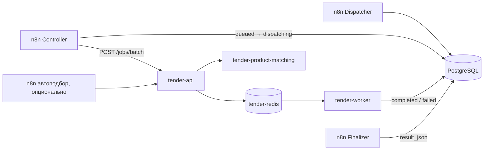

# Архитектура Tender Autofill Service

## Назначение

Сервис получает уже созданное n8n задание тендера, разбирает данные Seldon и приложенные документы, подбирает товарные позиции и записывает совместимый с Finalizer `result_json`. PostgreSQL остаётся источником истины для входа, статуса и результата; Python не создаёт отдельную базу и не заменяет n8n Finalizer.



В Redis передаётся только ключ Celery-задачи. Полный `input_json`, документы и результат остаются в PostgreSQL.

## Ответственность компонентов

| Компонент | Ответственность |
|---|---|
| Dispatcher | Нормализует CSV/Seldon-строки, создаёт `batch` и `queued` jobs. |
| Controller | Владеет окном параллельности, retry и stale recovery, переводит job в `dispatching`. |
| tender-api | Проверяет API key и статус job, публикует задачу, отвечает `202`. |
| tender-worker | Атомарно делает `dispatching → processing`, выполняет pipeline, пишет `completed/result_json` или `failed/error_message`. |
| tender-redis | Изолированный Redis-брокер Celery, не Redis/BullMQ n8n. |
| Finalizer | Читает PostgreSQL, создаёт CSV и завершает batch. |
| tender-product-matching | Отдельная вспомогательная очередь загрузки документов и XLSX автоподбора; в Daily-потоке не участвует. |

Celery не делает самостоятельных retry. Повторяет job только Controller через PostgreSQL.

## Pipeline тендера

1. Worker получает Seldon-данные, ссылки и доступные структурированные позиции.
2. Загрузчик безопасно скачивает и разбирает документы, архивы, PDF и Office-файлы.
3. Детерминированный разбор находит таблицы и позиции; table-schema audit отделяет спецификации от форм и шаблонов.
4. LLM анализирует отдельные документы или ограниченные группы, возвращая позиции, характеристики, кандидаты полей, причины и evidence.
5. Обязательная консолидация связывает результаты документов, дедуплицирует позиции и строит общий набор доказательств.
6. Валидация соединяет кандидатные значения, Seldon и детерминированные правила.
7. Общий товарный pipeline проверяет характеристики, формирует запросы, ищет кандидаты каталога/Qdrant и выполняет аудит до и после поиска.
8. Детерминированные причины и финальная LLM формируют решение, после чего `result.py` строит наружный JSON.

Общий `analysis_pipeline` и `product_pipeline` используют и основной worker, и отдельный сервис автоподбора: правила не должны расходиться между ними.

## Ошибки, таймауты и полнота

Успешная обработка не требует успеха каждого отдельного документа. Если LLM-анализ unit не удался, batch сначала разбирается по одному документу; неуспешный документ получает `analysisIncomplete`, а остальные продолжают давать доказательства. Это видно в `warnings` и `debug.documentAnalysis.incompleteUnitIds`.

Консолидация документного анализа, обязательные товарные аудиты, финальное решение и запись результата — фатальные этапы. Их ошибка переводит job в `failed`: сервис не выдаёт частично заполненный успешный тендер. Общий soft timeout Celery также всегда завершает задачу ошибкой, не превращаясь в warning.

По умолчанию основной worker имеет soft/hard limits 25/28 минут. Они должны оставаться меньше stale timeout Controller. Каждый контейнер работает с `prefork`, `concurrency=1`, `prefetch=1`, `max-tasks-per-child=1`: один дочерний процесс обрабатывает один тендер, контейнеры масштабируются горизонтально.

## Policy выключенных полей

В `app/services/field_policy.py` временно выключены:

- национальный режим;
- условия отгрузки и все сроки поставки;
- отсрочка оплаты;
- причина отказа по отсрочке 90 дней и более.

Это policy switch: правила, промпты и archived regression tests остаются в репозитории. Выключенные поля исключаются из промптов, консолидации, валидации и наружного `result_json`.

## Внешний результат

`result_json` содержит `fields`, `meta`, `productCheck`, `decision`, `warnings`, `logs`, `debug`, `reportFields` и идентификаторы тендера. Он является контрактом с n8n Finalizer.

Перед сохранением Python не дублирует исходные Seldon-колонки даты подачи, ссылки и цен, не отдаёт выключенные и контрагентские колонки, приводит `Код ТО` к `Dep_<код>`, а статусы и известные причины — к кодам справочника целевой системы. Любое изменение ключей должно проверяться вместе с Finalizer.

## Кодовая структура

```text
app/
  api.py                       HTTP API, health, metrics
  tasks.py                     Celery boundary и статусы jobs
  pipeline.py                  orchestration основного тендера
  db.py                        PostgreSQL transitions
  observability.py             run/event audit и heartbeat
  services/
    analysis_pipeline.py       разбор документов и консолидация
    field_policy.py            switches полей/причин
    field_prompts.py           сохранённые правила LLM
    product_pipeline.py        общий подбор товара
    product_extraction.py      извлечение позиций
    product_reconciliation.py  дедупликация и сверка
    result.py                  внешний JSON и справочные коды
tests/
  archived/                    регрессии выключенных полей
```

Подробный lifecycle приведён в `PROCESS_FLOW.md`; настройка Controller — в `N8N_INTEGRATION.md`; аудит запусков — в `OBSERVABILITY.md`.
