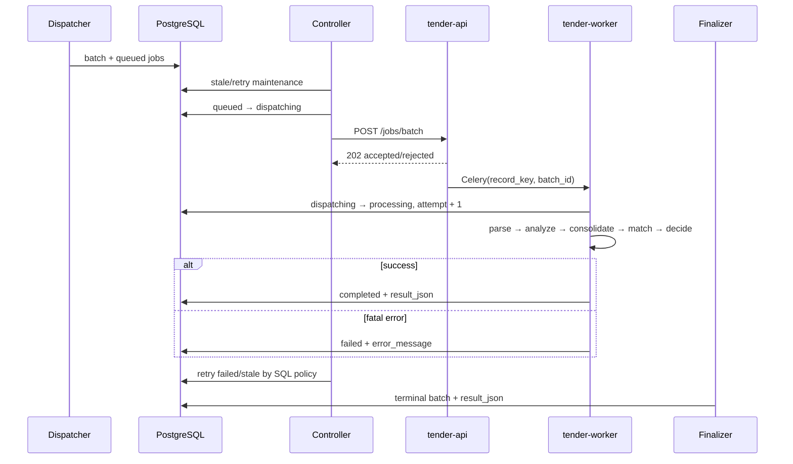

# Процесс обработки: Dispatcher → Python → Finalizer

PostgreSQL совместно используется n8n и Python. n8n создаёт и планирует job, Python выполняет тяжёлую обработку, Finalizer читает тот же `result_json` из БД.

## Статусы

| Статус | Владелец | Значение |
|---|---|---|
| `queued` | Dispatcher / Controller | Ожидает свободное окно. |
| `dispatching` | Controller | Выбран для публикации в Python. |
| `processing` | Python worker | Атомарно взят worker. |
| `completed` | Python worker | Результат записан. |
| `failed` | Python worker | Сохранён `error_message`; Controller может повторить. |

## Dispatcher и Controller

Dispatcher сохраняет исходные CSV-поля в `input_json.reportFields` и создаёт валидный job как `queued`, `attempt=0`, `input_valid=true`. Невалидный вход terminal `failed` и не повторяется.

Controller освобождает stale/retryable jobs, под advisory lock считает активные `dispatching + processing`, занимает доступное число строк через `FOR UPDATE SKIP LOCKED` и переводит их в `dispatching`. Затем одним HTTP-вызовом передаёт массив job в API. Controller — единственный владелец retry; Celery `max_retries=0`.

## Worker

Worker не доверяет одному сообщению Redis: сначала он делает `UPDATE ... WHERE status='dispatching'`. Это защищает от duplicate delivery. Затем он создаёт отдельный временный каталог и выполняет pipeline.

Ошибки отдельных документов не останавливают обработку: они сохраняются как warnings и incomplete units. Ошибка консолидации, обязательного товарного аудита, финального решения или общий soft timeout являются фатальными и записывают `failed`. Ошибка выгрузки XLSX на Яндекс.Диск не фатальна: основной `result_json` сохраняется с warning.

## Finalizer

Finalizer не вызывает Python API и не читает Redis/Qdrant. Он ждёт terminal batch, читает результаты из PostgreSQL, формирует CSV и запускает дальнейшую доставку.

Seldon-колонки даты окончания приёма заявок, ссылки и цен берутся из исходной строки/БД, а не из `result_json`: Python их намеренно не дублирует. Не добавляйте в SQL Finalizer выключенные поля отгрузки/сроков/оплаты, национального режима, контрагентские поля, обеспечения и worker-служебные колонки.

## Асинхронный автоподбор

`POST /product-matching/jobs` принимает multipart-документы и возвращает `jobId`. Состояние: `GET /product-matching/jobs/{jobId}`. Готовый XLSX: `GET /product-matching/jobs/{jobId}/download`.

Эта вспомогательная очередь не создаёт Daily job и не меняет batch/result_json.
